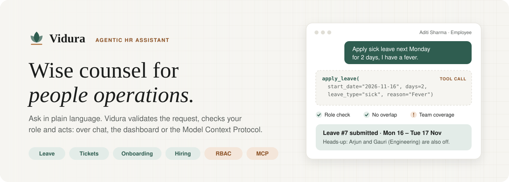
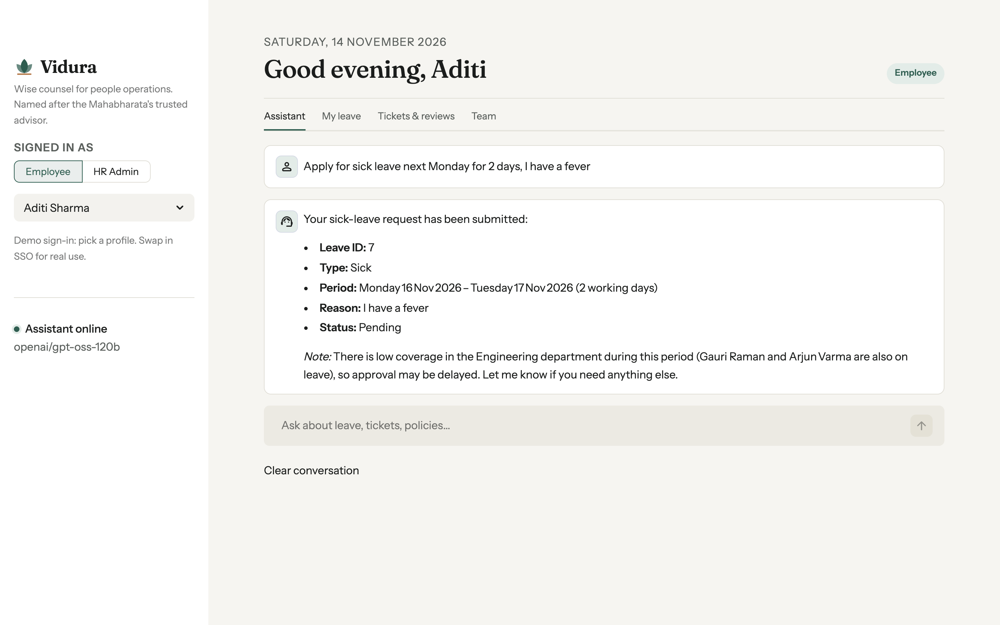
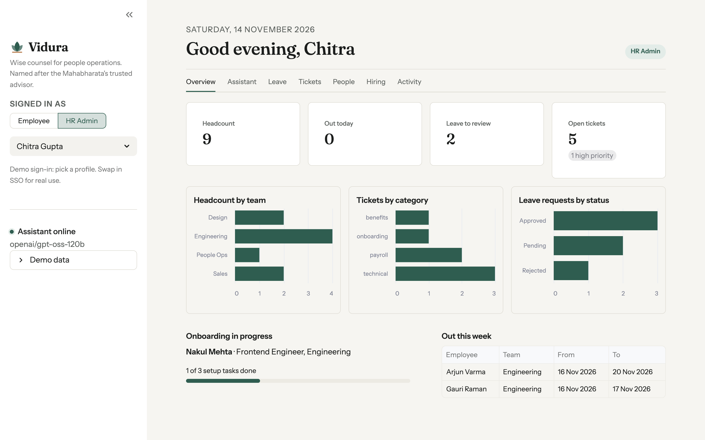
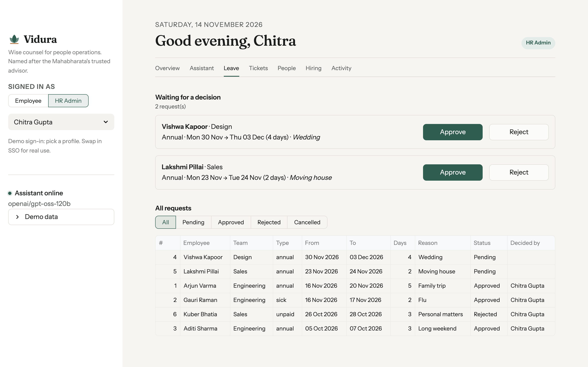
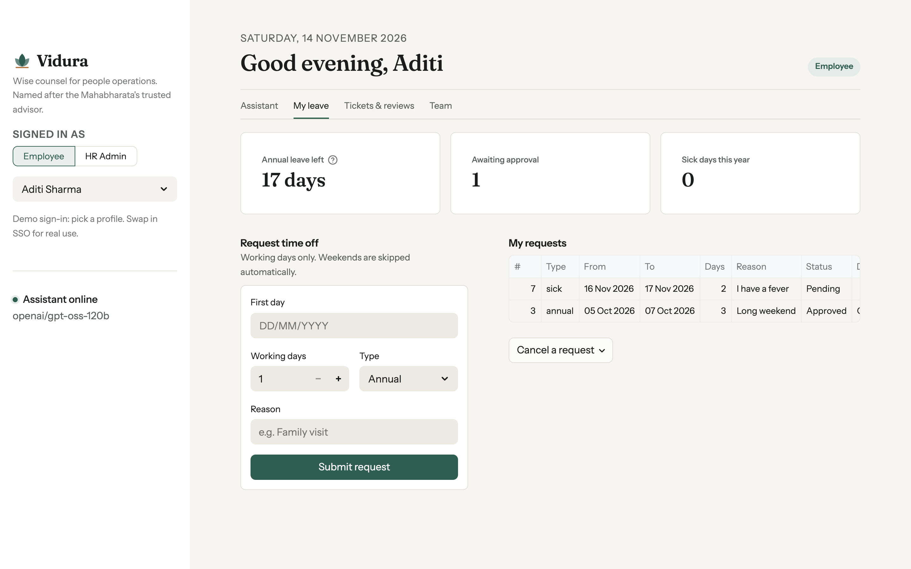
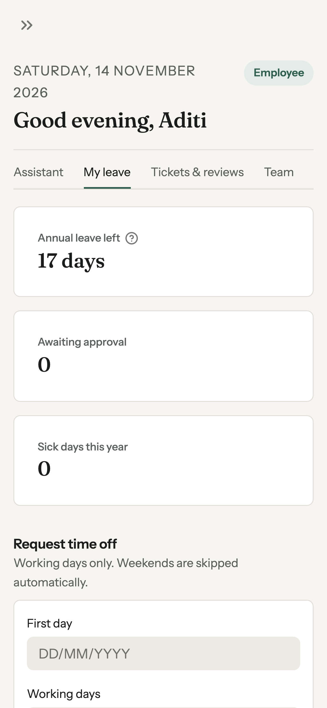
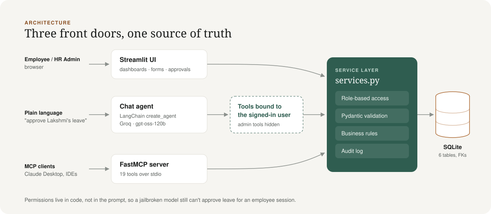
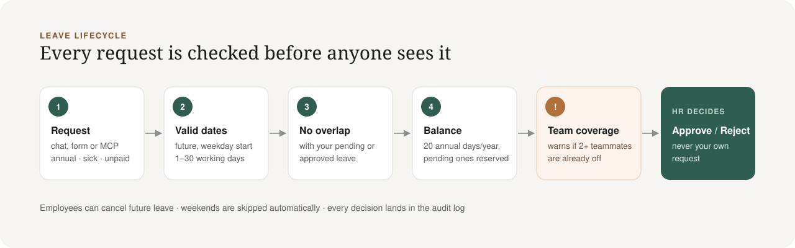
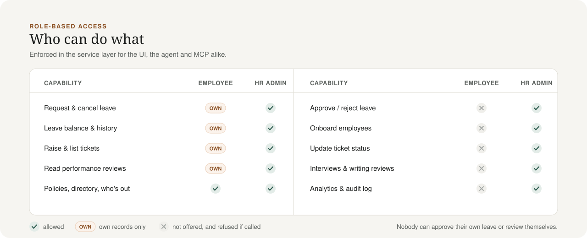

<div align="center">



<br/>

**Vidura** is an agentic HR assistant named after the wise counsellor of the Mahabharata.<br/>
Ask in plain language: it validates the request, checks your role, and acts.

<br/>

[](https://vidura.streamlit.app/)


[](https://github.com/Kaushik-verse/vidura-agentic-hr-assistant/actions/workflows/ci.yml)


[**Live demo**](https://vidura.streamlit.app/) · [Features](#-what-it-does) · [Screenshots](#-screenshots) · [Architecture](#-architecture) · [Run it](#-run-it-locally) · [MCP](#-use-it-from-any-mcp-client) · [Tests](#-quality)

</div>

<br/>


## ✦ What it does

| | Module | Highlights |
|:-:|---|---|
| 🪷 | **Conversational assistant** | Tool-calling agent on Groq. Resolves "next Monday" against a real calendar, looks up IDs instead of guessing, and replies with confirmed details. |
| 🗓️ | **Leave management** | Annual, sick and unpaid leave · working-day maths · yearly balance · overlap checks · cancel future leave · **team-coverage warnings** |
| 🎫 | **Tickets** | Payroll, technical, benefits and more · low/medium/high priority · Open → In Progress → Resolved → Closed |
| 🚀 | **Onboarding** | One request creates the employee plus IT, payroll and orientation tickets in a single transaction, with a progress bar per new hire |
| 🤝 | **Hiring & reviews** | Interview booking with interviewer clash detection, outcomes, 1–5 performance reviews visible to the employee |
| 📊 | **Analytics & audit** | Headcount by team, who's out, leave and ticket breakdowns, and an audit log of every change, whoever or whatever made it |

## ✦ Screenshots

<table>
  <tr>
    <td width="50%"><br/><sub><b>Assistant:</b> one sentence becomes a validated leave request, with a coverage heads-up</sub></td>
    <td width="50%"><br/><sub><b>HR overview:</b> headcount, who's out, tickets and onboarding at a glance</sub></td>
  </tr>
  <tr>
    <td width="50%"><br/><sub><b>Leave queue:</b> approve or reject in one click; every decision is audited</sub></td>
    <td width="50%"><br/><sub><b>Self-service:</b> balance, request form and history for employees</sub></td>
  </tr>
</table>

<details>
<summary><b>📱 Mobile view</b></summary>
<br/>
<p align="center"></p>
</details>

## ✦ Architecture



The Streamlit UI, the chat agent and the MCP server all call the same `services.py`, so validation,
permissions and audit logging behave the same everywhere. The agent's tools are built for each request
and bound to the signed-in user, so the model can never choose who it acts as.





<details>
<summary><b>🗂️ Project structure</b></summary>

```
app.py                     Streamlit UI (forms + assistant), no business logic
hr_assistant/
├── config.py              Settings from environment / .env, logging
├── db.py                  SQLite schema and transactional connections
├── models.py              Pydantic models: User, enums, validated inputs
├── services.py            Business rules + RBAC + audit (single source of truth)
├── tools.py               LangChain tools bound to the signed-in user
├── agent.py               Tool-calling agent on Groq
├── mcp_server.py          FastMCP server exposing the same tools
└── demo_data.py           Sample company, dates relative to today
assets/style.css           UI styles
.streamlit/config.toml     Theme
tests/                     Services, RBAC, agent, MCP and UI smoke tests
docs/images/               README graphics
```
</details>

## ✦ Meet the demo company

The sample data loads on first run (and HR can restore it from **Demo data → Reset**).
Every name is drawn from Indian mythology:

| Person | Role | Why the name |
|---|---|---|
| **Chitra Gupta** | HR Business Partner *(admin)* | Chitragupta, keeper of every soul's records |
| **Aditi Sharma** | Data Scientist | Aditi, the boundless mother of the gods |
| **Arjun Varma** | Backend Engineer | Arjuna, the focused archer |
| **Gauri Raman** · **Nakul Mehta** | ML / Frontend Engineers | Gauri (Parvati) · Nakula, the Pandava twin |
| **Vishwa Kapoor** · **Maya Sen** | Product Designer · UX Researcher | Vishwakarma, divine architect · Maya, the art of illusion |
| **Lakshmi Pillai** · **Kuber Bhatia** | Account Executive · Sales Manager | Lakshmi and Kubera, keepers of wealth |

## ✦ Run it locally

> Running the code is permitted only for evaluating the author's work. See [License](#-license).

No setup needed to try it: the [live demo](https://vidura.streamlit.app/) runs the same app with the sample company (data resets when the app restarts).

Requires Python 3.11+ and a free [Groq API key](https://console.groq.com/keys). [uv](https://docs.astral.sh/uv/) is recommended.

```bash
git clone https://github.com/Kaushik-verse/vidura-agentic-hr-assistant.git
cd vidura-agentic-hr-assistant
cp .env.example .env          # add GROQ_API_KEY
uv sync
uv run streamlit run app.py
```

<details>
<summary>Using pip instead</summary>

```bash
python -m venv .venv && source .venv/bin/activate
pip install -r requirements.txt
streamlit run app.py
```
</details>

Open http://localhost:8501 and pick **Employee** or **HR Admin** in the sidebar.
Without an API key everything except the assistant still works.

### Try these prompts

| As **Aditi Sharma** (Employee) | As **Chitra Gupta** (HR Admin) |
|---|---|
| How many leave days do I have left? | Show pending leave requests and approve Lakshmi's |
| Apply for sick leave next Monday for 2 days, I have a fever | Onboard Abhimanyu Rao as a UX Designer in Design |
| My laptop won't turn on, raise an urgent ticket | Book an interview with Eklavya Singh for Data Analyst next Friday at 3pm with Aditi Sharma |
| Show Arjun's leave history → *politely refused* | Give me today's HR summary |

### Configuration

| Variable | Default | Purpose |
|---|---|---|
| `GROQ_API_KEY` | — | Enables the assistant |
| `HR_MODEL` | `openai/gpt-oss-120b` | Any Groq model with tool calling |
| `HR_DB_PATH` | `data/hr.db` | SQLite file |
| `HR_SEED_DEMO_DATA` | `true` | Load the demo company into an empty database |
| `HR_ANNUAL_LEAVE_DAYS` | `20` | Annual leave allowance |
| `HR_COVERAGE_THRESHOLD` | `2` | Teammates already off before the coverage warning fires |
| `LOG_LEVEL` | `INFO` | Logging level |
| `HR_MCP_USER` / `HR_MCP_ROLE` | `Aditi Sharma` / `Employee` | Identity for the MCP server |

## ✦ Use it from any MCP client

The same 19 tools, with the same validation and permissions, over the Model Context Protocol:

```bash
HR_MCP_USER="Chitra Gupta" HR_MCP_ROLE="HR Admin" uv run hr-mcp
```

```json
{
  "mcpServers": {
    "vidura": {
      "command": "uv",
      "args": ["--directory", "/path/to/vidura-agentic-hr-assistant", "run", "hr-mcp"],
      "env": { "HR_MCP_USER": "Aditi Sharma", "HR_MCP_ROLE": "Employee" }
    }
  }
}
```

## ✦ Quality

```bash
uv run pytest           # 36 tests, no network or API key needed
uv run ruff check .     # lint
uv run ruff format .    # format
```

- **Services:** every business rule and permission boundary, with a frozen clock
- **Agent:** a scripted chat model drives the real agent loop, including a prompt-injection attempt to call an admin tool
- **MCP:** in-memory FastMCP client against the real server
- **UI:** Streamlit `AppTest` renders both roles and approves a leave request

GitHub Actions runs lint, format checks and the full test suite on Python 3.11 and 3.13 for every push and pull request.

<details>
<summary><b>Known limits</b></summary>

- Sign-in is a demo profile picker; a real deployment would sit behind SSO (permissions already live in the service layer).
- SQLite suits a single instance; swap `db.py` for Postgres to scale out.
- Public holidays are not modelled; leave counts weekdays.
</details>

## ✦ License

**Copyright © 2026 Ch Sai Kaushik. All rights reserved.**
This repository is public for portfolio viewing only. No permission is granted to copy, use, modify or
distribute any part of it without written consent; see [LICENSE](LICENSE). Hiring teams may run it
locally to evaluate the work.

<div align="center">
<br/>
If Vidura is useful or interesting, a ⭐ helps more people find it.

<sub>Built by <b>Ch Sai Kaushik</b> · B.Tech CSE (Data Science), VIT Vellore · <a href="https://github.com/Kaushik-verse">@Kaushik-verse</a></sub>
</div>
